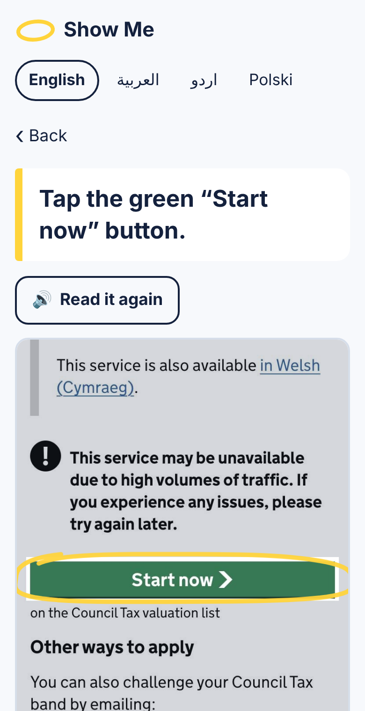

# Show Me

**Stuck on a government website? Send a screenshot and it shows you exactly what to tap, in your language.**

**Live demo:** https://mohammed-890.github.io/show-me/



## The problem

Around 2.8 million people in the UK are offline, and millions more have very low digital skills (Ofcom). They include older people, disabled people and people who have just moved to the UK. Many public services now only work online: registering with a GP, checking a Council Tax band, proving immigration status with an eVisa.

Most of the time people do not need a new app. They are on the right page and do not know which of the twenty things on the screen to press. Cookie banners, “Start now” buttons below the fold and radio buttons with no obvious next step are where people give up or phone a relative.

## What it does

1. Pick a task (Council Tax band, register with a GP, eVisa share code).
2. When you get stuck, take a screenshot and add it.
3. Show Me draws a yellow highlighter loop around the one thing to tap, and reads the instruction out loud in English, Arabic, Urdu or Polish.

If the button is further down the page, it tells you to scroll. If the screen isn't part of the task, it says so instead of guessing.

**Privacy:** everything runs in the browser. The screenshot is never uploaded. OCR runs with a self-hosted copy of Tesseract, and there's no server, no analytics and no tracking.

## How it works

```
screenshot ─► OCR (2 passes) ─► lines ─► which step is this? ─► find the target ─► loop + voice
```

- **Two-pass OCR** (`docs/js/ocr.js`). A full-page pass, plus a second pass on solid-colour regions (buttons, banners), each cleaned to dark-on-white. Plain OCR misses white text on green GOV.UK buttons, and this fixes that.
- **Step guides written from the real pages** (`docs/js/tasks.js`). Each step has a *signature* (text that identifies the screen), a *target* (button, text box or radio options) and an instruction in four languages. The engine can only point at something a guide names, so it never invents a button.
- **Fuzzy matching** (`docs/js/engine.js`). Character-level approximate substring matching (Sellers' algorithm) copes with OCR errors like `nationalidentity` or `Start nowy`.
- **State checks.** The engine looks at pixels to tell whether the postcode box already has text in it, or whether a radio button is already selected, then moves on to the next step (“Good, your postcode is in. Now tap Search”).
- **Interrupts.** Cookie banners and the NHS “confirm you are human” check take priority over whatever page is behind them.

## Results

Tested on 80 screenshots: 16 captured from the live GOV.UK, NHS and UKVI pages in October 2026, plus 64 harder variants the engine was never tuned on (72% size, heavy JPEG with blur, scrolled differently, dimmed screen). A prediction counts as correct if the centre of what it points at lands inside the real button (ground truth taken from the page's DOM), or if it says “scroll” when the button is off-screen.

| Method | Original (16) | Held-out variants (64) | All (80) |
|---|---|---|---|
| **Show Me** | **16/16 (100%)** | **63/64 (98%)** | **79/80 (99%)** |
| Show Me without state checks | 13/16 (81%) | 51/64 (80%) | 64/80 (80%) |
| Baseline: “first line starting with an action word” | 4/16 (25%) | 12/64 (19%) | 16/80 (20%) |

The engine runs in 5.5 ms median (p95 19.6 ms) after OCR. OCR takes about 2–3 s per screenshot in a browser.

The one failure is the dimmed NHS “confirm you are human” page. OCR loses the faint heading, and the engine answers “I don't recognise this screen” rather than guessing. I left it in rather than tuning for it.

Reproduce:

```bash
npm install
python3 scripts/augment.py        # build the held-out variants
node eval/run-eval.mjs            # writes eval/results/latest.json
```

## Limitations

- Three tasks only. Adding one means writing a step guide from the live pages, which takes about 30 minutes per task.
- Tested on screenshots, not on photos of a screen taken with another phone.
- The Arabic, Urdu and Polish instructions should be reviewed by native speakers before real use.
- The GP flow stops at the NHS human check, which Show Me explains but never solves for you. The eVisa flow stops before sign-in.
- Government pages change. A guide that stops matching fails safely (“I don't recognise this screen”), but needs updating.

## Project layout

```
docs/            the website (GitHub Pages serves this folder)
  js/engine.js   matching, state checks, step choice (pure, no DOM)
  js/ocr.js      two-pass OCR, shared by the site and the evaluation
  js/tasks.js    step guides and translations
  js/app.js      UI, highlighter loop, speech
  vendor/        self-hosted tesseract.js 5.1.1 + English model
  examples/      real screenshots for “Try an example”
eval/            labels, screenshots, evaluation script, results
scripts/         augmentation script
```

## Credits

Screenshots of GOV.UK and NHS pages are Crown copyright / NHS, used under the [Open Government Licence v3.0](https://www.nationalarchives.gov.uk/doc/open-government-licence/version/3/). OCR by [Tesseract](https://github.com/tesseract-ocr/tesseract) via [tesseract.js](https://github.com/naptha/tesseract.js) (Apache 2.0).

Show Me is not an official government or NHS service.

Built by [Mohammed Banabilh](https://www.linkedin.com/in/mohammed-banabilh-6340553b0/). MIT licence.
